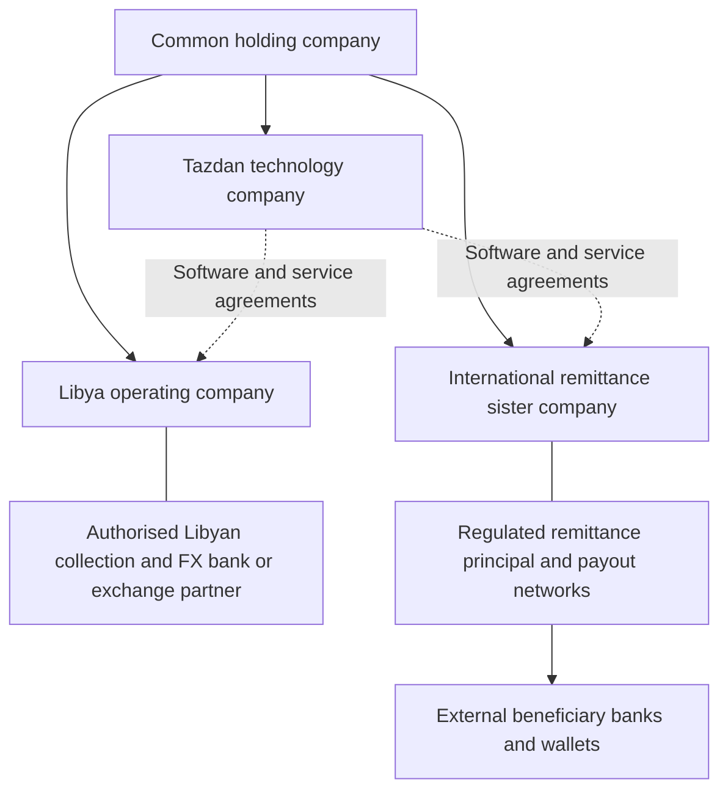

# Ult, Tazdan, and a global remittance business

Decision memo | 17 October 2026

Prepared from Ult's public product and legal materials, selected Tazdan source files and internal audits, and current regulator publications. This is a commercial and engineering assessment and a structure for legal review. It does not establish permission to operate any corridor.

## Investment decision

**Continue developing Tazdan, with the next investment concentrated on regulated money movement and business payments. Keep the broader financial-services ambition, but earn it through reliable collection, conversion, payout, and reconciliation.**

Ult is a useful benchmark for simplifying a trading experience. Tazdan's potential advantage is dependable access to financial services for customers with difficult local funding and cross-border payment needs. The existence of an underserved market does not itself prove a viable business: the same barriers can make that market uneconomic or legally inaccessible.

The proposed sister company could strengthen the business by operating an independent remittance service, paying beneficiaries outside Tazdan, and eventually serving other businesses through an API. Its value comes from permitted activities, banking relationships, liquidity, execution, and distribution.

### Ratings

These are subjective decision scores, not estimated probabilities of success. They reflect the evidence available here, rather than an audit of either company's financial performance.

| Question | Rating | Interpretation |
|---|---:|---|
| Ult's publicly presented trading features and product proposition | **8/10** | Coherent proposition with broad speculative-market access; actual execution and regional availability were not independently tested. |
| Ult's commercial success potential | **7/10** | Credible ecosystem and a clear proposition, balanced against competition, product restrictions, and dependence on trading activity. |
| Tazdan's existing software foundation | **7/10** | Substantial money, business, and operations functionality; material integration and entity-accounting work remains. |
| Tazdan's readiness for the proposed global live service | **3/10** | The reviewed source contains sandbox external payout rails; production permission, funding, partners, and operational evidence are not established. |
| Tazdan as an operating-business investment today | **5/10** | Worth a bounded validation investment; insufficient evidence for unrestricted spending on a global super-app rollout. |
| Tazdan's strategic potential after key gates are met | **8/10, conditional** | Depends on lawful LYD collection and outward settlement, willing counterparties, repeat customers, and positive contribution margin. |

Confidence is moderate in the software distinctions and lower in commercial outcomes. No verified cohort retention, customer acquisition cost, audited volumes, partner contracts, or profitability data were available. I did not access production, conduct a security audit, or rerun the repository's historical tests.

## What Ult does similarly, better, and worse

Ult's launch materials describe a common balance for spot trading, equity/commodity/crypto perpetuals, and sports predictions, with fiat and crypto funding. This is a broad trading proposition. [Cronos Labs launch strategy](https://blog.cronos.com/p/cronos-labs-strategy-going-forward).

Its current website also promotes broader prediction markets, self-custody, social/passkey sign-in, and fees shown before confirmation. Social following and desktop sections are marked as coming soon; those should receive roadmap credit rather than assumed delivery credit. Equity perpetuals give price exposure and should not be treated as evidence of conventional share ownership. [Ult product website](https://ult.trade/).

Ult's terms describe non-custodial services, exclude the US and Ontario, allow additional feature restrictions, and disclose possible third-party charges. Those terms do not establish that every advertised feature is authorised everywhere else. [Ult terms](https://ult.trade/ult-app-terms-and-conditions/).

| Dimension | Ult | Tazdan | Assessment |
|---|---|---|---|
| Crypto access and conversion | Public trading offering | Trading and conversion code exists; venue failures can leave Tazdan as principal | Similar surface; Tazdan needs stronger evidence of executable liquidity and hedging. |
| Multi-asset trading | Perpetuals and predictions are central to its proposition | No comparable verified service in the reviewed files | Ult has the broader trading proposition. Replication would expand Tazdan's permissions and risk burden. |
| Customer promise | A clear trading purpose | A broad collection of wallets, transfers, crypto, cards, budgets, business, and remittance functions | Ult communicates its main job more clearly. Tazdan should lead with a reliable payment outcome. |
| Funding | Launch materials advertise multiple funding methods | Manual bank confirmation and on-ramp adapters; activation unverified | Ult has a stronger public funding proposition. Tazdan needs approved, reconciled collection accounts. |
| Everyday transfers | No comparable bank-remittance business established by the reviewed materials | Internal payments, claim links, escrow, remittance lifecycle | Tazdan has the more relevant software for everyday money movement; external delivery remains unproven. |
| Business operations | Not established from reviewed public materials | KYB, teams, approvals, API keys, bulk payments, webhooks | Tazdan has a promising business-payment foundation. Current bulk payments principally serve Tazdan recipients. |
| Cards | No card programme verified for this assessment | Screens and issuer interface exist; real issuing implementation incomplete | No demonstrated live advantage for Tazdan here. |
| Local currency workflows | No Libya-specific advantage verified | Explicit LYD pricing and Libya corridor logic | Potential Tazdan differentiation, subject to lawful pricing, collection, and settlement. |
| Custody | Self-custody proposition | Server-side custodial infrastructure plus other wallet components | Different responsibilities. Neither model alone proves superior security. |
| Distribution | Existing Cronos/Onchain product lineage | No independently verified acquisition or retention advantage | Ult has the clearer ecosystem starting point. Inherited app reviews are not evidence of adoption of every new trading feature. |
| Operations | Internal controls not visible | Ledger, compliance cases, treasury, audit and staff cockpit in code | Tazdan's controls are inspectable here; no fair claim that they exceed Ult's unseen controls. |

The app listing identifies the Crypto.com Onchain Wallet transition. Treat that as product lineage, not proof that the new Ult business already has profitable customers. [Apple listing](https://apps.apple.com/us/app/ult-trade-stocks-crypto/id1512048310).

**Copy the simplicity:** fast onboarding, clear available balances, transparent total cost, reusable recipients, and a consistent confirmation flow. Build the trust experience around payout evidence, understandable delays, refunds, and support. Adding speculative products would not solve Tazdan's current funding and settlement gaps.

## What the repository actually supports

Recent audit documents are more conservative than the older investor brief. Source inspection supports several important distinctions:

| Finding | Evidence | Business implication |
|---|---|---|
| External payout adapters are sandbox implementations; the live internal wallet adapter does not pay an external bank | [Provider registry](/Users/moe/Downloads/promrkts/server/src/services/providers/registry.ts:23) | International remittance requires real integration work and partner acceptance. |
| Twelve seeded corridors represent six two-way corridor pairs; none establish worldwide coverage | [Corridor catalogue](/Users/moe/Downloads/promrkts/server/src/services/remittance/corridors.ts:28) | US, Canada, and broader Asia/Africa coverage require new country, currency and provider configuration and integration. |
| The Stripe issuer implementation throws configuration/implementation errors | [Card issuer](/Users/moe/Downloads/promrkts/server/src/services/cardIssuer/index.ts:63) | A contract and credentials alone will not launch cards. |
| Principal fills are possible without successful venue execution, with exposure controls | [Principal exposure service](/Users/moe/Downloads/promrkts/server/src/services/exchange/principalExposure.service.ts:1) | A customer fill does not prove an external hedge or matching custody asset exists. |
| Bank-to-customer safeguarding reconciliation is documented as not automated | [Customer funds controls](/Users/moe/Downloads/promrkts/docs/regulatory/CUSTOMER_FUNDS.md:15) | Balanced books need independent confirmation against real bank and custody assets. |
| Ledger accounts lack a legal-entity dimension | [Ledger schema](/Users/moe/Downloads/promrkts/server/prisma/schema.prisma:778) | Separate sister companies need separate enforceable books and obligations. |
| Treasury pools have a text entity label, while selection uses provider and currency | [Pool selection](/Users/moe/Downloads/promrkts/server/src/services/treasury/pools.service.ts:62) | Adding a second entity requires ownership-aware liquidity selection and access controls. |
| A trade posting path maps USDC settlement to USDT | [Trade ledger mapping](/Users/moe/Downloads/promrkts/server/src/services/exchange/orderExecution.service.ts:57) | Distinct token and currency obligations need distinct accounting before expanding treasury services. |

The repository's [launch blockers](/Users/moe/Downloads/promrkts/docs/audit/LAUNCH_BLOCKERS.md) also include configuration, mobile testing, restore capability, an external penetration test, and investigation of a reported fund-integrity discrepancy. These are recorded outstanding items, not independently confirmed current production conditions.

## Proposed ownership and operating structure

The jurisdiction is undecided. Choose it after confirming which regulators and banks will accept the actual Libya-origin model, ownership, customer types, and funding sources.

**Holding company:** ownership, funding, and governance. A holding company can have a limited operational role; the company actually providing financial services needs the substance and permissions its activities require.

**Technology company:** owns or licenses the software, supplies approved outsourced services, and receives documented commercial fees. Calling an activity technology or orchestration does not make it unregulated if it actually controls customer funds or provides regulated payment services.

**Libya operating company:** performs only permitted activities, directly or through a properly approved local partner. Identify who contracts with the sender, collects LYD, performs lawful FX, submits outward payment instructions, and handles complaints.

**International remittance sister:** start, if accepted, as an approved agent/service partner under a named regulated principal. The principal must approve its role, countries, customers, collection, payout, and subcontracting. Alternatively obtain its own appropriate permissions. An ordinary incorporation does not confer either status.

A separate brand and customer journey can support users who never hold a Tazdan wallet. The sender must still accept the correct provider's terms and complete required checks. The recipient can receive into an external account or supported wallet without joining Tazdan. Shared ownership and shared identity tooling do not merge customer contracts, legal responsibility, or customer money.

Common ownership must be disclosed to banks and regulators. Beneficial-ownership transparency is a core expectation, not something a shell structure eliminates. [FATF beneficial ownership guidance](https://www.fatf-gafi.org/en/publications/Fatfrecommendations/Guidance-Beneficial-Ownership-Legal-Persons.html).

## Your reserve and approximate-settlement proposal

**The viable version is prefunded local payouts with precisely recorded intercompany obligations and legally permitted net settlement.** Money need not cross a border individually for every customer payment. The arrangement nevertheless transfers value for customers and needs the applicable permissions.

FATF describes money/value transfer by its economic function. Its settlement analysis also recognises netting in banks and remitters, while identifying risks where underlying transfers are obscured. [FATF glossary](https://www.fatf-gafi.org/en/pages/fatf-glossary.html), [FATF settlement analysis](https://www.fatf-gafi.org/content/dam/fatf-gafi/reports/Role-of-hawala-and-similar-in-ml-tf.pdf.coredownload.pdf).

### Example: Libya and the UK

Illustrative rate only: **GBP 1 = LYD 10**, ignoring fees. This is not a current or recommended rate.

| Event | Local execution | Intercompany effect |
|---|---|---|
| A sender pays LYD 10,000 for a UK beneficiary | Approved Libyan collector receives LYD; UK provider pays GBP 1,000 from an available prefunded pool | Libya side owes UK side GBP 1,000 under the agreed settlement contract. |
| A separate UK sender pays GBP 600 for a Libyan beneficiary | Approved UK collector receives GBP; Libya provider pays LYD 6,000 | UK side owes Libya side GBP 600, using the example's agreed conversion. |
| Eligible obligations are netted | Both original customer payments remain individually recorded | Net payable from Libya side to UK side: GBP 400. |
| Net amount is settled | An approved banking/FX route settles the GBP 400 obligation | Both companies close the corresponding payable/receivable. |

Netting is conditional on the contracts, permissions, safeguarding treatment, and enforceability in the relevant jurisdictions. It cannot be assumed merely because both companies belong to you.

If the sister only makes outward payouts, the second transaction never occurs: its foreign-currency reserve depletes while LYD accumulates in Libya. With GBP 100,000 available and GBP 20,000 net daily payouts, it has five days of coverage before other requirements and buffers. A receivable from Libya does not refill a UK bank account.

### Where approximate values are acceptable

Approximate values can support dashboards, forecasts, and estimates of future reserve needs. Customer promises and intercompany settlement need a defined amount and currency, an agreed lawful rate source and timestamp, rounding rules, fees, settlement dates, and treatment of FX gains or losses. Different customer and treasury execution rates can exist, but the differences must be recorded and allocated.

Use an intercompany settlement and liquidity agreement specifying credit limits, collateral where appropriate, FX risk ownership, pricing, reconciliation, default, and termination. Related-party treasury transactions also need analysis under applicable local transfer-pricing rules; OECD guidance provides an arm's-length framework, rather than a universal local rule. [OECD financial-transactions guidance](https://www.oecd.org/en/publications/2020/02/transfer-pricing-guidance-on-financial-transactions-inclusive-framework-on-beps-actions-4-8-10_278e0cb3.html).

### Distinguish reserves from customer funds

| Money held | Treatment to establish |
|---|---|
| Shareholder capital or a properly documented corporate credit facility | Corporate liquidity, subject to the applicable prudential, treasury, and lending rules. |
| Money received to execute a customer's transfer | Customer payment obligation; collection, safeguarding, execution, and release follow the approved model. |
| An ongoing stored customer balance | May add e-money, payment-account, or deposit-taking questions beyond a transfer-only service. |
| A receivable owed by the sister company | An intercompany credit exposure; not equivalent to available settlement cash or automatically an eligible safeguarding asset. |

An undelivered customer's funds are not free working capital for another entity. Neither corporate reserves nor a balanced group ledger replace any required safeguarding, regulatory capital, or bank guarantee. The exact treatment must be agreed with the principal, banks and counsel.

For the UAE, this arrangement may also raise registered-hawala classification questions. The CBUAE has an explicit registration framework, but the permitted scope is restricted: it is not a universal financial-services licence, and the guidance prohibits deposit-taking, currency exchange, and services such as crypto exchange under that permission. [CBUAE hawala guidance](https://rulebook.centralbank.ae/en/rulebook/annex-1-synopsis-guidance-0). Classification needs review; this memo does not establish eligibility for that route.

## Worldwide coverage: network design and jurisdiction choices

Build one platform capable of adding countries, supported by several regulated networks and correspondent banks. Actual availability is the intersection of **permitted origin, customer type, purpose, currency, destination, payout method, partner acceptance, sanctions screening, and available liquidity**.

Network research candidates include Nium, whose documentation advertises payouts to over 190 countries, and Thunes, whose network page advertises 140 countries. These are providers' coverage claims. **Neither source confirms acceptance of Tazdan, Libya-origin funds, LYD funding, your intended transaction types, or every country pair.** [Nium payouts](https://docs.nium.com/docs/payouts), [Thunes network](https://www.thunes.com/direct-global-network/).

| Destination or establishment | Structure to evaluate | Important boundary |
|---|---|---|
| Libya origin | Licensed collection and lawful FX/outward settlement through an approved bank/exchange arrangement | Overseas incorporation does not establish permission for the Libyan leg. |
| UAE | Licensed exchange/payment partner initially; assess own authorisation later | Under the current Exchange Business Regulation, digital-remittance Category IV has AED 25m minimum paid-up capital and an AED 25m bank guarantee; full foreign ownership is discretionary. Those are not an incorporation quote or necessarily two additive cash deposits. Do not confuse this category with similarly named categories in other rulebooks. |
| UK | Approved payment-services agent or own appropriate payment permission | UK-facing payment activity and stored value require a scope analysis; UK permission does not create EU or Libya authority. |
| EU | Appropriate licensed PI/EMI principal and local payout partners | Crypto permission alone does not resolve the payment-service perimeter; EMT-related services can involve both MiCA and payments requirements. |
| USA | A properly licensed US payout partner; a separate federal/state analysis for the group's own activities | Paying a US beneficiary is different from soliciting US senders, but neither automatically settles your own regulatory status. |
| Canada | Approved Canadian payout partner; assess FINTRAC, applicable provincial requirements and RPAA where relevant | FINTRAC registration is not a licence or endorsement; Bank of Canada payment registration is a distinct question. |
| Rest of North America, Asia, Africa and other regions | Country-level bank, wallet, card and cash-payout partners | A continent is not one regulatory market. Receiving transfers and collecting customer funds require separate consideration. |

Sources for the table: [CBL publication index](https://cbl.gov.ly/publications/), [CBUAE Exchange Business Regulation](https://rulebook.centralbank.ae/en/rulebook/exchange-business-regulation), [FCA payment institution applicants](https://www.fca.org.uk/firms/apply-emoney-payment-institution/pi), [EBA MiCA/payments guidance](https://eba.europa.eu/publications-and-media/press-releases/eba-advises-national-authorities-actions-take-end-transition-period-under-its-no-action-letter), [FinCEN foreign MSBs](https://www.fincen.gov/resources/advisories/fincen-advisory-fin-2012-a001), [New York licensing example](https://www.dfs.ny.gov/apps_and_licensing/money_transmitters), [FINTRAC registry explanation](https://fintrac-canafe.canada.ca/msb-esm/reg-eng?wbdisable=true), [Bank of Canada registration criteria](https://www.bankofcanada.ca/2026/06/criteria-for-registering-payment-service-providers/).

The CBL index lists Circular 6/2026 on direct external transfers through exchange companies and 14/2026 on banks' direct external transfers, as well as other FX/payment instructions. These are a reason to investigate the formal local route. Complete circular conditions, limits, eligible purposes, later amendments and any allowance for bilateral netting were **not fully verified** in this review. Do not infer approval for Tazdan's proposed model from publication titles.

The older repository licensing memo's suggestion that putting an entity and servers abroad resolves the Libya problem is not an established legal conclusion. Likewise, neither a published parallel rate nor an internal FX engine proves permission to execute at that rate. Sanctions eligibility requires current transaction and counterparty analysis, including ownership; it cannot be copied from a static country list. [OFAC Libya programme](https://ofac.treasury.gov/sanctions-programs-and-country-information/libya-sanctions).

## Becoming a complete financial-services platform

Build customer capabilities around their actual licensed provider and account type. A comprehensive interface can integrate several regulated businesses without your group becoming a bank for every service.

| Layer | Customer outcome | Build / obtain |
|---|---|---|
| Identity and protection | Onboarding, verification, permissions, accessible support, complaints | Build journey and audit; obtain accepted identity tools and compliance operations. |
| Accounts and money | Clear balances, local funding, statements, appropriate customer-money protection | Entity-specific books, actual bank/payment account connections, accurate disclosures. |
| FX and international transfers | Exact receive amount, total price, ETA, external payout, traceable refund | Approved FX sources, live collection/payout adapters, treasury and reconciliation. |
| Business finance | KYB, roles, supplier payments, invoices, bulk payouts, API, accounting exports | Extend the existing business foundation to approved external beneficiaries. |
| Spending | Virtual/physical cards and merchant payments where supported | Issuer/sponsor and acquiring contracts; real implementation, disputes and settlement. |
| Savings | Goals first; later eligible bank savings or investment products | Keep budgeting pots distinct from deposits, yield products and investment accounts. |
| Investing and crypto | Optional permitted custody, exchange and investment access | Separate appropriate permissions, custody, execution and asset-specific reconciliation. |
| Credit and insurance | Later partner products where customer demand supports them | Appropriate underwriting/distribution permissions and clear provider responsibility. |

Give users a simple daily journey: see available money, add funds, send/pay, track, and obtain support. Additional services can appear when available to that customer, entity, country and provider.

## Required engineering changes for the sister-company model

1. **Separate legal books.** Introduce legal entities and entity-scoped ledger accounts, journal groups, customer relationships, treasury pools, provider credentials, bank accounts, permissions, and financial reports. Enforce ownership in database constraints and access controls. Separate deployments/databases are an option if they make this isolation easier to operate.
2. **Record the contract.** Every quote and transfer must identify the contracting entity, regulated principal, sender jurisdiction, permitted funding source, disclosure version, and applicable route policy.
3. **Make netting explicit.** Add settlement agreements, exact intercompany payable/receivable entries, approved FX conversions, netting batches with gross underlying references, aging, due dates, confirmations, and cash settlement evidence. Group consolidation must not erase subsidiary obligations or gross transaction records.
4. **Use real assets.** Keep GBP, USD, USDC, USDT and other instruments distinct. Add country/currency metadata, account formats, minor units, settlement calendars, and asset/network identifiers rather than assuming the current finite currency catalogue covers the world.
5. **Filter routes before pricing.** An eligible route needs approved origin and destination, purpose, customer type, legal-entity coverage, funded liquidity, limits, and live provider health. Cheapest routing comes after those checks.
6. **Protect liquidity.** Reserve funds atomically, cap intercompany credit and FX exposures, monitor depletion and settlement aging, and stop new quotes/acceptance when a lawful funded route is unavailable. Forecast inbound flows separately from money already available.
7. **Reconcile independently.** Match customer obligations, entity ledgers, bank/custody balances, provider statements, outstanding payments, and intercompany statements. Netting must preserve a complete transaction-level trail.
8. **Complete live integrations.** Signed callbacks, unknown-status handling, duplicate prevention, payout returns, refunds, and statement ingestion must pass provider certification and controlled live testing.
9. **Run an independent service.** Standalone customer onboarding, terms, receipts, support and API access for RemitCo; Tazdan becomes one authorised distribution channel, rather than a mandatory wallet destination.

## Economics: judge the business after liquidity and delivery costs

Illustrative bank-funded model only; these are not quoted provider prices, permitted charges, a forecast, or a full capital plan.

Assume 2.0% gross customer revenue, 1.2% variable costs including payment/FX execution, expected losses, variable compliance/support and allocated acquisition costs, and USD 40,000 monthly fixed overhead. That leaves 0.8% contribution before fixed overhead.

| Monthly transfer volume | Gross revenue | Variable costs | Contribution | After assumed fixed overhead |
|---:|---:|---:|---:|---:|
| $1m | $20,000 | $12,000 | $8,000 | -$32,000 |
| $5m | $100,000 | $60,000 | $40,000 | $0 |
| $10m | $200,000 | $120,000 | $80,000 | $40,000 |

Break-even volume in this example is $40,000 / 0.008 = **$5m per month**. At only 0.4% contribution it becomes $10m; at 1.2% it becomes about $3.33m. Minimum fees and ticket sizes can materially change those percentages. Card funding can change the cost structure substantially.

At $5m monthly outflow, three calendar days of average gross payout coverage is roughly **$500,000**, before peak demand, weekends, pending payments and stress buffers, assuming no inbound offset. It is a working-liquidity illustration, separate from regulatory capital, safeguarding, guarantee collateral, setup costs and operating runway. Reserve planning should use actual net cash flows and settlement delays by currency and provider.

Charging fees between your own companies can allocate profit and compensate real services; it does not create extra consolidated group revenue. Prefunding improves timing but does not remove FX cost, trapped-currency risk, bank rejection, credit loss, or replenishment needs.

## Next investment and decision gates

Use the next 90 days as a validation programme, not a promised licensing or launch timetable.

| Workstream | Concrete evidence required |
|---|---|
| Origin feasibility | Written scope analysis from Libyan and proposed operating-jurisdiction counsel; a bank/exchange partner willing to support the actual LYD collection and outward or net-settlement model. |
| Destination feasibility | Written partner confirmation of Libya-origin acceptance, permitted purposes/customer types, supported payout countries and actual commercial terms. |
| Treasury | Funded reserve plan, approved replenishment channel, entity-specific cash forecasts and credit limits; a workable one-way-flow stress case. |
| Customer demand | Interviews and, once permitted, observed repeat payments from a defined consumer or business segment; no need to market every service simultaneously. |
| Software and operations | Entity separation, independent reconciliation, resolved integrity questions, restore evidence, device testing, security review, and provider-certified end-to-end execution. |
| Commercial viability | Positive contribution after execution, losses, compliance/support and acquisition, plus a credible route to covering fixed costs and funding liquidity. |

**Proceed:** counterparties accept the real model, lawful funding and replenishment exist, pilot delivery and reconciliation are reliable, and repeat usage supports viable margins.

**Change approach:** if the origin or replenishment model is not bankable, offer the software and operations tooling to existing licensed banks/exchange companies, with them controlling the regulated service and customer funds. This reuses the strongest Tazdan assets while changing who operates the money business.

**Stop expanding financial features temporarily:** if investment is producing more screens without producing permission, reliable payout, reconciled assets, customers, or economic evidence. The next milestone should be a working, permitted payment business.
