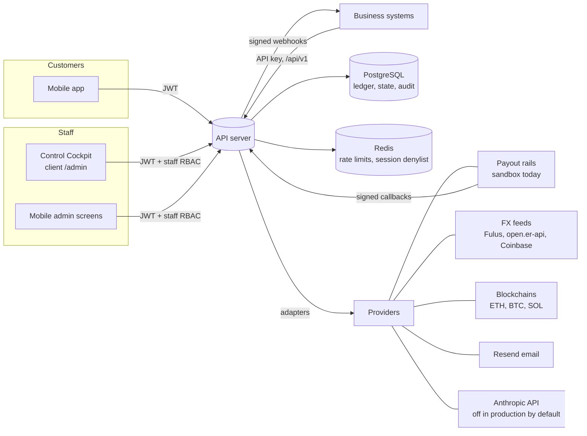
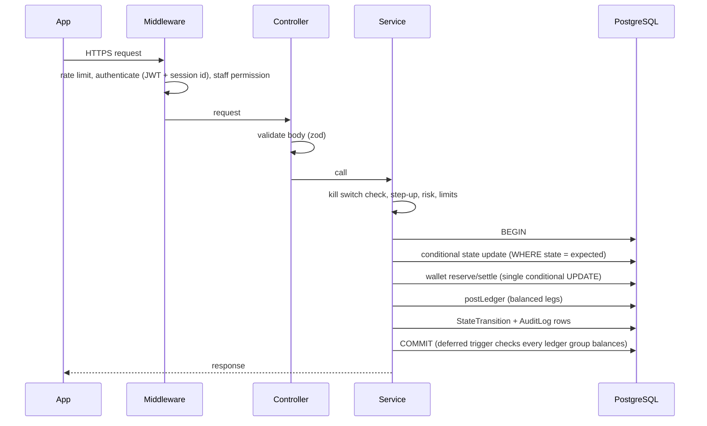

# Architecture

Tazdan (repository `promrkts`) is three applications sharing one API.

| Application | Stack | Location | Hosting |
|---|---|---|---|
| API server | Node 24, Express 4, TypeScript, Prisma 5, PostgreSQL, Redis, Socket.IO | `server/` | Docker on one DigitalOcean droplet behind nginx (`api.promrkts.com`) |
| Mobile app (consumer, business, staff) | Expo SDK 54, React Native, expo-router | `mobile/` | App stores (EAS builds), OTA updates |
| Website + Control Cockpit | Next.js 14 App Router, Chakra UI | `client/` | Vercel (`promrkts.com`; cockpit at `/admin`) |

## Context



## Server layout

```
server/src/
  index.ts                 app, middleware order, router mounts, background workers
  routes/                  one router per area (customer, admin, cockpit, business, v1, remittance…)
  controllers/             request validation (zod) and response shaping
    cockpit/               Control Cockpit API (overview, customers, operations, money, risk, analytics, ai)
  services/
    ledger/                postLedger, adjustments, reconciliation + trading halt
    wallet/                atomic reserve/settle/release, transfers, on-chain settlement, custody
    remittance/            corridors, pricing, routing, state machine, lifecycle, refunds
    treasury/              pools, movements, reservations, alerts
    reconciliation/        provider statements, integrity checks, resolution
    risk/                  rule engine (17 rules), risk events
    compliance/            screening (watchlists), cases
    providers/             registry, guard (no mocks in production), sandbox payout rails
    business/              access (roles), payouts, API keys, webhooks
    platform/              RBAC, kill switches, approvals (maker-checker), audit, lifecycle, metrics, bootstrap
    ai/                    assistant, read-only tools
    exchange/              FX rates, conversions, overrides, order execution
  middleware/              auth (sessions), apiKey, rate limiters, error handler
prisma/                    schema (96 models) and 53 migrations
```

## Request path



## Core design rules

1. **Money moves only through the ledger.** Every movement posts a balanced journal (`postLedger`); the wallet table is a read model kept in step inside the same transaction. A deferred constraint trigger rejects any transaction whose ledger group does not balance per currency. See [LEDGER.md](LEDGER.md).
2. **State changes are conditional.** `UPDATE … WHERE status = <expected>` and a check that exactly one row moved. Every lifecycle change writes an append-only `StateTransition`. See [TRANSACTIONS.md](TRANSACTIONS.md).
3. **Evidence is immutable.** Ledger entries, audit log, state transitions, security events, treasury movements and similar tables reject UPDATE/DELETE at the database.
4. **No fake success in production.** Mock and sandbox adapters throw when `NODE_ENV=production` ([PROVIDERS.md](PROVIDERS.md)); static fallback prices are refused for executable quotes.
5. **Least privilege and dual control for staff.** Every staff route declares a permission; sensitive actions need a second person. See [SECURITY.md](SECURITY.md) and [CONTROL_COCKPIT.md](CONTROL_COCKPIT.md).
6. **Idempotency on every retried write.** Remittance creation, business batches and the public API take idempotency keys; provider callbacks are matched on provider reference and are idempotent.

## Background workers

Started by `bootstrapPlatform({ workers: true })` in the API process (single worker when clustering is off):

| Worker | Interval | Purpose |
|---|---|---|
| Remittance worker | 15 s (`REMITTANCE_WORKER_MS`) | Poll in-flight payouts, expire stale quotes/transfers |
| Reconciliation scheduler | 30 min (`RECON_INTERVAL_MS`) | Provider statements, internal payouts, integrity checks |
| Ledger reconciliation | 5 min (`LEDGER_RECONCILE_MS`) | Cache drift and conservation; sets the trading halt on a break |
| Provider health | 60 s | Health check per provider; feeds routing |
| Webhook delivery | 15 s | Signed business webhooks with retries |
| Metrics sampler | 5 min | `SystemMetricSample` snapshots for the cockpit |
| Existing schedulers | various | Recurring buys, budget contributions, fund-integrity audit, operational alerts |

## Data stores

- **PostgreSQL** is the system of record (balances, ledger, lifecycle, audit). Schema: [DATABASE.md](DATABASE.md).
- **Redis** holds rate-limit counters (fails open), the session denylist and short-lived codes. The platform runs without Redis with reduced guarantees (per-process limits, revocation by token expiry).
- **File storage**: uploaded KYC documents in the `uploads` volume (backed up with the database).

## Related documents

[SYSTEM_CONTEXT.md](SYSTEM_CONTEXT.md) · [DATABASE.md](DATABASE.md) · [API.md](API.md) · [DEPLOYMENT.md](DEPLOYMENT.md) · [TESTING.md](TESTING.md)
