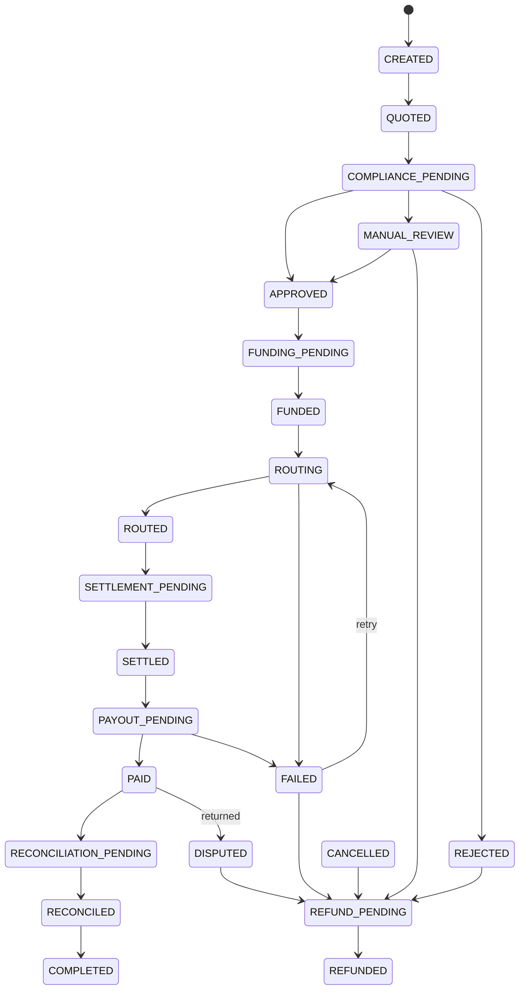

# Remittance

Cross-border transfers from a Tazdan wallet to a bank account, mobile wallet, cash pickup or another Tazdan wallet. Code: `server/src/services/remittance/`; customer API `/api/remittance`; mobile screens `mobile/app/remit/`; operations in the Control Cockpit (Remittance page). **All corridors are `SANDBOX_ONLY` today** — the full lifecycle runs against simulated payout rails; no real money leaves Tazdan.

## Corridors

Twelve default corridors, Libya to and from the United Kingdom, Egypt, Turkey, UAE, the euro area and Tunisia. Each has a status (`LIVE`, `SANDBOX_ONLY`, `PAUSED`, `DISABLED`), limits (in the receive currency), payout methods, purposes, source-of-funds threshold, rate floor/ceiling, quote TTL and pricing. Seeded pricing (configurable in the cockpit, not a commercial commitment):

| Corridor | Fixed fee | Fee % | FX margin |
|---|---|---|---|
| LY-GB / LY-EU | 10 LYD | 0.50% | 1.50% |
| GB-LY / EU-LY | 2 GBP / 2 EUR | 0.50% | 1.50% |
| LY-EG / LY-TN | 5 LYD | 0.40% | 1.20% |
| LY-TR / LY-AE | 8 LYD | 0.40% | 1.30% / 1.20% |
| EG-LY / TR-LY / AE-LY / TN-LY | 50 EGP / 30 TRY / 10 AED / 3 TND | 0.40% | 1.20–1.30% |

Setting a corridor `LIVE` is refused unless an enabled production payout rail serves it. In production a `SANDBOX_ONLY` corridor refuses to quote.

## Golden flow: Tripoli → London, £1,000

1. **Beneficiary** — Mohammed adds his daughter with a UK sort code and account number (validated; IBANs are checked with mod-97). She is screened against loaded watchlists.
2. **Quote** — base rate = mid of the FX engine pair (Fulus parallel rate first for LYD); customer rate = base × (1 − spread × (1 − tier discount)); fee = fixed + percent × send; total = send + fee. The quote is an immutable database record valid for the corridor TTL. The route engine ranks every rail and records why each was or was not eligible ([ROUTING.md](ROUTING.md)).
3. **Create** — idempotency key; risk-based step-up; limits; source of funds above the threshold; sender and beneficiary screening; risk engine decision.
   - `REJECT/BLOCK` → transfer `REJECTED`, compliance case opened, nothing debited.
   - `REVIEW` → funds debited into `REMITTANCE_CLEARING`, transfer held in `MANUAL_REVIEW`, case opened.
   - otherwise → funded and routed.
4. **Review (if held)** — a compliance officer approves (continues) or rejects (full refund including the fee). The decision closes the case.
5. **Route and settle** — liquidity reserved in the chosen rail's treasury pool under a row lock.
6. **Payout** — submitted to the rail; status arrives by signed callback or polling. `PAID` posts the payout journal (customer clearing to treasury and revenue; destination leg out of treasury).
7. **Reconciliation** — the provider statement is matched; the transfer moves `RECONCILED → COMPLETED`.

The reverse flow (London → Tripoli into a Tazdan wallet) credits the beneficiary's wallet through the internal `TAZDAN_WALLET` rail. Both flows are executed end to end in `remittance.golden.test.ts`.

## Lifecycle

The full edge list (23 states) is `EDGES` in `stateMachine.ts`; any other change is refused. Every transition writes a `StateTransition` row.

## Failure handling

| Event | Behaviour |
|---|---|
| Provider rejects or times out on submission | Payout marked with the outcome; unknown outcomes stay `SUBMITTED` and are resolved by polling or reconciliation, never retried blind |
| Payout `FAILED` | Liquidity released; operator can retry on a new route, otherwise automatic full refund |
| Payout returned after `PAID` | Paid journal reversed exactly, pool liquidity restored, transfer `DISPUTED`, full refund |
| Customer cancels | Before routing: cancelled; after funding: refunded; while at the provider: provider cancel attempted, refunded if accepted, refused otherwise |
| Goodwill refund after delivery | Maker-checker (`REMITTANCE_REFUND`), paid from `PLATFORM` |
| Quote expired | Creation refused; customer sees the new price |

## Customer communication

The customer API and app collapse internal states into neutral wording ("Processing", "Delivered", "Delayed", "Refunded"…) and never expose risk scores, provider references, screening status or compliance reasons (CL-42).

## Sandbox rails

`services/providers/adapters/sandboxPayout.ts` simulates each rail with its SLA. Amounts ending in specific cents trigger outcomes for testing: `.13` FAILED, `.31` RETURNED, `.77` fee mismatch in the statement, `.88` amount mismatch. `SANDBOX_TIME_SCALE` compresses SLAs in tests.
