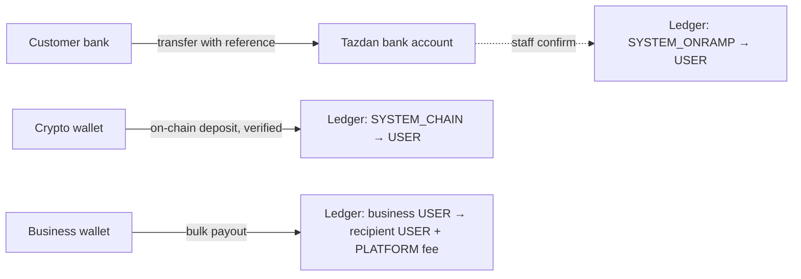
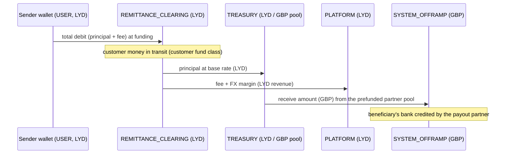

# Funds flow

> Technical description of controls implemented in software. It is not legal advice, does not describe a licensed activity, and implies no regulatory approval. Tazdan holds no licence referenced in this repository.

## Customer money in

## Remittance (Tripoli → London)

Refund before payout: clearing → sender, in full including the fee. Payout returned after payment: the paid journal is reversed leg for leg, then refunded. Goodwill refund after delivery: platform revenue → sender (dual control).

## Money out

| Path | Controls | Ledger |
|---|---|---|
| Bank withdrawal | KYC, limits, step-up, screening + risk engine, staff approval | USER → SYSTEM_OFFRAMP (+ PLATFORM fee) |
| On-chain withdrawal | kill switches, 2FA, address allow-list (24 h), KYC limits, address screening + risk engine | USER → SYSTEM_CHAIN; refund on broadcast failure |
| Remittance payout | above | see diagram |

All journals balance per currency; the database rejects unbalanced groups at commit. See [../LEDGER.md](../LEDGER.md).
