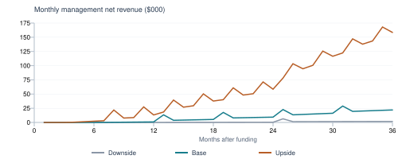

## Tazdan: investment assessment

Product, commercial viability and the sale of 33%

Prepared for the founder | 10 November 2026
Source review, isolated software checks and a 36-month conditional financial model.

Current negotiating view: $0.75m-$1.50m pre-money, with low confidence. A concrete proposal to test is $650,000 for 33%: $600,000 to the company and $50,000 gross to you.

This is a negotiation judgment, not an independently certified fair-market valuation or an indication that a buyer will pay it. No priced offer, local comparable sale, paid pilot or production banking agreement establishes a market price today. The company could receive a lower offer or no offer.

### The software has substance; the business is still unproven

The current source contains substantial wallet, ledger, business-payment and operational software. Fresh checks passed 415 server tests across 53 suites and server, web and mobile type checks. That supports a controlled pilot discussion. It does not establish commercial launch authority, live financial-provider execution, national operating capacity or willingness to pay.

The strongest initial business is a narrow business-payment workflow or institution operations/reconciliation product. Charge for approvals, reporting, integration and support after proving a customer benefit. A broad consumer wallet, crypto exchange, card issuer and international transfer platform would multiply licensing, liquidity, partner and execution demands before demand is known.

| Year 3 conditional outcome | Base | Upside |
| --- | --- | --- |
| Month-end transacting consumers | 3,111 | 24,140 |
| Paying businesses / institutions | 245 / 4 | 971 / 10 |
| Annual management net revenue | $229,355 | $1,496,220 |
| Annual operating result | ($340,920) | $183,457 |

The base plan remains loss-making in year 3. It needs approximately $557,000 through month 18 and $1.27m through month 36 including a 20% contingency, before unknown regulatory capital, guarantees, tax and transaction costs. The upside requires materially stronger distribution and more settlement cash. Neither is measured demand.

Sources: S1, S13; model and analyst judgment. Figures and assumptions as of 10 November 2026.

## 1. What exists, and what has not been established

| Business evidence today | Assessment implication |
| --- | --- |
| No paying users, revenue or signed commercial/licensing partners reported | No observed acquisition cost, retention, margin or accepted selling price. |
| Verbal assurance from a CBL official | Useful access; no written permission, product scope, licence or right to launch established. |
| Founder alone; practically zero cash; no current monthly cash cost reported | The model requires funded staff. Unpaid founder time is an economic cost and key-person dependency. |
| Single-digit interested audience, merchants and investors in total | Interest does not establish an active user base or an investable sales pipeline. |
| Libyan incorporated company, about two years old | Cap table, IP assignment, accounts, tax, debts and contingent claims still need document review. |
| Merger approach: team, SF investor connection, CBL relationships | Potential execution help. No committed investment, signed bank contract or customer distribution evidenced. |

### Evidence standard

Source code establishes implemented logic, not production adoption. Automated tests establish behavior within their environment, including mocks. Bank/provider credentials, a feature flag, a price feed or a corridor configuration do not establish a working, lawful and commercially accepted financial service. A verbal regulatory assurance receives no contracted revenue or licence value in this model.

### Verification completed

All 61 database migrations applied to a new disposable PostgreSQL 18 cluster on a random loopback port. The server suite passed 415 tests with none skipped. Server, client and mobile TypeScript checks passed. The existing user database and production services were not used. The prior iOS build and native widget storage handoff were verified earlier in this chat.

### Boundaries of this assessment

This is not a security audit, regulatory opinion, source-ownership audit, production load certification, financial statement audit or independent bank settlement test. No live customer balances, provider contracts, bank statements or regulator documents were supplied. The review includes modified working files, not only the last Git commit. No numerical probability of national-scale success can be responsibly estimated from this evidence.

Sources: S1, S13. Figures and assumptions as of 10 November 2026.

## 2. Feature assessment: payments and distribution

Implementation status, commercial use and the remaining dependency are assessed separately. "Implemented" is not a claim of production certification. Evidence references E1-E18 are indexed on page 15.

### E1. Wallets, ledger and internal payments

Status: Implemented; isolated tests pass. Commercial use: Enables a limited wallet/payment pilot after permission and bank setup. Customer principal is not revenue. Dependency: External reserve backing and live bank reconciliation unverified.

### E2. Merchant Pay and QR

Status: Implemented internal Tazdan payment URL. Commercial use: Merchant subscription and collection fees are future contract hypotheses. Dependency: No national LYPay/OnePay/NUMO integration found in implementation search; closed-network adoption and cash-in/out remain dependencies.

### E3. Business bulk payouts, roles and approvals

Status: Implemented; DB-backed tests pass. Commercial use: Strong candidate for paid payroll/vendor workflow pilots. Dependency: Recipients resolve to Tazdan users; not a live external-bank payout service. Fee defaults to zero unless configured.

### E4. Public API, API keys and signed webhooks

Status: Implemented. Commercial use: Supports paid integration and recurring software/API contracts. Dependency: No metered subscription billing implementation found in business routes/services; contractual billing and entitlement operations required.

### E5. Bank deposits and withdrawals

Status: Staff-driven controls implemented. Commercial use: Funding and redemption are prerequisites to customer usefulness. Dependency: Staff confirmation and an internal ledger do not establish automated bank collection, cash availability or reconciled external settlement.

### E6. International remittance

Status: 12 corridor configurations; eight external sandbox payout adapters. Commercial use: Possible fee and FX margin only after legal and commercial execution is proven. Dependency: No signed live destination rails supplied. All external rails in source registry are sandbox; internal Tazdan wallet is the production adapter.

Sources: S13; current working source. Figures and assumptions as of 10 November 2026.

## 3. Feature assessment: financial products

Implementation status, commercial use and the remaining dependency are assessed separately. "Implemented" is not a claim of production certification. Evidence references E1-E18 are indexed on page 15.

### E7. FX and market-price quotes

Status: Price/quote code implemented. Commercial use: A disclosed spread can produce margin only with lawful, funded and reconciled conversion. Dependency: A feed or parallel-rate quote is not executable liquidity, a licence or profit. Counterparty and inventory costs must be included.

### E8. Crypto execution and recurring purchases

Status: Real-money production crypto trading hard-disabled. Commercial use: Zero revenue in all core forecasts. Dependency: Reserve/submit/reconcile/finalise execution and venue certification remain required; regulation and banking acceptance unresolved.

### E9. P2P escrow marketplace

Status: Code implemented; production switch applies. Commercial use: Potential fees require willing buyers, sellers, liquidity and dispute operations. Dependency: No marketplace liquidity, retention or safe live settlement demonstrated; excluded from core revenue.

### E10. Cards and physical-card orders

Status: Mock issuer and throwing Stripe Issuing stub. Commercial use: Card-order fees and interchange excluded. Dependency: Issuer contracts, production implementation, certification, costs and eligible-country coverage unproven. Wallet QR passes are not issued payment cards.

### E11. Card/gateway on-ramp and off-ramp

Status: Mock defaults; Stripe adapter; other stubs. Commercial use: No guaranteed card-funding or withdrawal margin. Dependency: Production guards refuse mocks; credentials alone do not prove Libyan entity onboarding or processor acceptance.

### E12. On-chain custody and transfers

Status: Implemented custody paths and controls. Commercial use: Excluded until authority, custody audit, key recovery and banking treatment are established. Dependency: Network connectivity is not institutional custody assurance; gas, screening, key security and recovery costs remain.

Sources: S13; current working source. Figures and assumptions as of 10 November 2026.

## 4. Feature assessment: controls and operations

Implementation status, commercial use and the remaining dependency are assessed separately. "Implemented" is not a claim of production certification. Evidence references E1-E18 are indexed on page 15.

### E13. LYDT dinar token and reserve controls

Status: Sandbox; feature flag off by default in production. Commercial use: Zero issuance, reserve yield or token fees included in core forecast. Dependency: No CBL authorization, actual CBL reserve account, attestation arrangement or audited issuance supplied.

### E14. Compliance, KYB, risk rules and limits

Status: Workflow controls implemented. Commercial use: Necessary operating capability; potential scoped software licence. Dependency: Current watchlist data, institutional acceptance, approved policies and qualified accountable staff not evidenced.

### E15. Cockpit, treasury and reconciliation

Status: Substantial operational tooling implemented. Commercial use: Best candidate for an isolated, paid institution operations pilot. Dependency: Multi-tenant bank-core readiness, external reconciliation acceptance and contracted institution demand not established.

### E16. AI operations and support

Status: Integration and review controls present; production off by default. Commercial use: Possible productivity benefit; no standalone licence revenue assumed. Dependency: No measured staff-time savings or willingness to pay. Model usage and review remain costs.

### E17. Mobile/web experience, chat, budgets and widgets

Status: Types pass; iOS build and widget handoff verified earlier in this chat. Commercial use: Supports usability and retention; no separate forecast fee. Dependency: No cohort retention, acquisition conversion or broad mobile UI regression evidence. Widgets do not demonstrate product-market fit.

### E18. Availability rules, production guards and scaling

Status: Current source includes fail-closed controls and Redis socket adapter. Commercial use: Supports controlled pilot rollout. Dependency: No national-scale certification, production capacity result or independent restore drill supplied. Old data-room statement that a Redis adapter is missing is stale.

Sources: S13; current working source. Figures and assumptions as of 10 November 2026.

## 5. Market opportunity and competitive position

### A real payment market already has operators and rails

CBL reported approximately LYD865bn of broad electronic transaction value through September 2026. This supports the existence of large system activity, not the number of people Tazdan can acquire or the fees it can retain. CBL financial inclusion strategy prioritises interoperability and digital business/government payments. It does not commit procurement or customers to Tazdan. [S2, S3]

LYPay describes Moamalat as operating the instant-payment infrastructure under CBL assignment. The CBL developer portal specifies NUMO QR formatting and payment execution. Tazdan currently produces its own payment URL; no implementation evidence establishes national QR interoperability. The commercial route is likely to require integration and an approved role alongside existing operators. [S5, S6, S13]

CBL lists payment companies by service and decision; current scope and validity must be checked directly because the directory includes older dates. Dafa markets seven local methods and offers either a 3% indirect-collection price or direct collection with a subscription. That is competitor advertising, not verified volume or profit, and it does not establish Tazdan pricing or a statutory fee ceiling. [S4, S7]

### Three plausible entry markets

| Buyer / problem to validate | Offer to test | Evidence required |
| --- | --- | --- |
| Small and mid-size employers: approvals, payroll/vendor files, audit trail | Paid workflow subscription with a defined supported payment route | Paid pilot, measured staff time saved and confirmed recipient cash-out. |
| Merchants: collection, receipts, reconciliation and integration | Subscription plus a permitted collection fee | Approved rail, settled cash, repeat use and margin after all partner charges. |
| Banks/payment institutions: operations and reconciliation backlog | Scoped isolated software deployment and support contract | Named sponsor, security review, acceptance criteria, implementation budget and renewal. |

### What cannot be used as Tazdan demand

CBL bank FX-use totals include corporate activity; the reported $19.34bn total and $2.68bn transfer category are not addressable retail-remittance revenue. World Bank notes Libya used an abridged 2024 survey with omitted receiving-payment fields, limiting comparisons. Bank accounts, cards and transaction events also cannot be summed into unique people. This assessment therefore uses a bottom-up acquisition model rather than an asserted share of national totals. [S8, S9]

Potential differentiation is a reliable business workflow, easy integration, accepted controls and customer service. Code breadth alone is reproducible. Defensibility would come from contracted distribution, approved integrations, trusted settlement operations, retained customers and the cost of replacing an embedded workflow. None is yet measured.

Sources: S2-S9, S13; entry-market selection is analyst judgment. Figures and assumptions as of 10 November 2026.

## 6. How the company could earn money

| Revenue stream | Proposed base price | Present evidence / treatment |
| --- | --- | --- |
| Business workflow subscription | $40 / $45 / $50 per month in years 1 / 2 / 3 | Proposed, untested. Billing and commercial entitlement operations still needed. |
| Domestic merchant collections | 0.5% gross fee on chargeable payments | Only 35% / 40% / 45% of retail payments chargeable. Partner costs deducted. |
| Business payouts | $0.15 gross per successful payout | Code defaults to zero unless configured. Requires accepted commercial terms. |
| Institution operations software | $2,000 monthly plus $10,000 accepted setup | No contract signed. Setup is one-time; no institution churn assumed, an optimistic renewal assumption. |
| Crypto, cards, LYDT, remittance, custody yield | Zero in the core forecast | Regulatory, execution, counterparty and commercial dependencies unresolved. |

### Unit economics: retained income is much smaller than payment value

$35 merchant payment: a 0.5% fee earns $0.175. A partner cost of 0.15% plus $0.02 consumes $0.0725. Retained fees are $0.1025; a 0.02% loss allowance leaves $0.0955 before customer support, verification and fixed staff. Ten thousand such payments contribute only about $955 before those costs. These are assumed terms, not quoted margins.

$50 business subscription: after a 10% direct-vendor allowance, $45 remains. Forty monthly payout attempts at 98% completion add $4.90 after a $0.025 partner cost against the $0.15 fee. Payout-loss allowance removes about $0.94 at a $120 ticket. About $49 remains before fixed staff, acquisition and related consumer costs. A $120 cash onboarding cost plus payroll needs retention to pay back.

$2,000 institution contract: a 20% vendor allowance leaves $1,600 monthly before fixed team costs. A $10,000 setup fee at 60% external delivery cost leaves $4,000 once. Scope creep, custom support and slow collection could consume that contribution.

### Accounting and products outside the forecast

Management net revenue is platform fees after partner pass-through costs, plus business subscriptions, institution recurring fees and accepted setup fees. Actual statutory gross/net presentation depends on principal/agent contract analysis. Customer payment principal and safeguarded funds are never revenue, company capital or unrestricted spending cash.

Remittance spread is not automatically profit: on an illustrative $750 transfer, a 0.5% fee is $3.75; assumed provider FX cost of 0.35%, a $1 fixed charge and a 0.03% loss allowance leave negative $0.10 before operations. A 1.2% fee would leave $5.15 on the same assumptions. This is a sensitivity illustration only; no such corridor economics are established. FX feeds, token reserves and card interchange are assigned no current earnings value.

Sources: S1, S10, S13; all prices and costs here are analyst hypotheses. Figures and assumptions as of 10 November 2026.

## 7. User acquisition, retention and activity

There is no defensible statistical expected user count today. The following are conditional planning cases, not probability-weighted forecasts. Funding, written permissions, an operating team, supported rails and workable funding/redemption are prerequisites. Without them, modeled payment activity is zero.

| Acquisition / activity driver | Downside | Base | Upside |
| --- | --- | --- | --- |
| Months before operating launch | 12 | 6 | 3 |
| Qualified business leads/month, Y1 / Y2 / Y3 | 15 / 25 / 40 | 40 / 80 / 140 | 80 / 180 / 350 |
| Lead to paid activation | 5% | 10% | 15% |
| Monthly business churn | 2.5% | 1.5% | 0.8% |
| Consumer prospects per new business | 10 | 20 | 30 |
| Unique funded share of those prospects | 50% | 70% | 80% |
| Monthly consumer churn | 10% | 7% | 5% |
| Retail payment attempts/user/month, Y3 | 3 | 6 | 9 |
| Payment completion assumption | 95% | 98% | 99.5% |

### How the counts are constructed

New businesses equal qualified leads times paid conversion. Paying businesses roll forward after monthly churn. New transacting consumers come from activated businesses, paid acquisition and deduplicated referrals; consumer churn removes inactive cohorts. Businesses/users are expected cohort counts, so internal calculations may be fractional. Transactions use average opening/closing customers in each month; end-of-year customer counts are not multiplied across the full year.

Base consumer acquisition spend rises from $500 to $1,500 per month; assumed funded-customer cash acquisition cost falls from $25 to $20. Merchant and paid channels are assumed to introduce distinct people. The model infers registrations from a 35% registration-to-funded conversion; registrations are cumulative, not monthly active users. Referrals assume 1% of prior active consumers each month. None of these rates has been observed.

| End of year 3 / activity during year 3 | Downside | Base | Upside |
| --- | --- | --- | --- |
| Transacting consumers | 303 | 3,111 | 24,140 |
| Cumulative inferred registrations | 2,742 | 17,177 | 86,534 |
| Paying businesses / institution contracts | 31 / 1 | 245 / 4 | 971 / 10 |
| Annual successful payment events | 13,346 | 255,369 | 2,519,284 |
| Annual principal processed | $0.61m | $16.07m | $194.18m |

Retail transfers and business payouts are separate events; deposits, withdrawals, receipt notifications and ledger legs are not counted again. Single-digit current prospects do not yet support the assumed lead volumes. The acquisition plan must be rebuilt from an actual named pipeline.

## 8. Revenue and operating results over 36 months

| Case | Year | Net revenue | Operating result | End users | End businesses |
| --- | --- | --- | --- | --- | --- |
| Downside | 1 | $0 | ($99,900) | 0 | 0 |
|  | 2 | $2,159 | ($192,344) | 151 | 13 |
|  | 3 | $24,063 | ($238,380) | 303 | 31 |
| Base | 1 | $3,103 | ($188,488) | 393 | 23 |
|  | 2 | $97,057 | ($276,131) | 1,562 | 108 |
|  | 3 | $229,355 | ($340,920) | 3,111 | 245 |
| Upside | 1 | $85,805 | ($268,362) | 2,901 | 105 |
|  | 2 | $531,807 | ($227,223) | 10,375 | 405 |
|  | 3 | $1,496,220 | $183,457 | 24,140 | 971 |

Conditional monthly net revenue; peaks include one-time accepted institution setup fees.

### Base revenue mix in year 3

Retained payment fees: $18,393; business subscriptions: $106,962; institution recurring fees: $84,000; one-time setup: $20,000. Subscriptions and institutional delivery supply most income. In contrast, $16.07m in payment principal is not company revenue.

Operating result is before tax, depreciation/amortisation, financing and one-time launch-preparation cash. The base case never reaches monthly operating breakeven in 36 months. The upside first has a positive month at M23, then becomes negative again as costs step up; it remains positive from M29 through M36 in this model. A positive month does not eliminate liquidity funding needs. No terminal value or success probability is assumed.

Sources: Analyst model, evaluated 10 November 2026; periods are relative to funding, not calendar years. Figures and assumptions as of 10 November 2026.

## 9. Staffing, runway and settlement capital

| Base monthly economic cost | Year 1, after launch | Year 2 | Year 3 |
| --- | --- | --- | --- |
| Engineering FTE x loaded monthly pay | 2.5 x $3,500 | 3 x $4,000 | 4 x $4,500 |
| Compliance/finance FTE x loaded pay | 1 x $2,500 | 1.5 x $3,000 | 2 x $3,500 |
| Sales/support/operations FTE x loaded pay | 2 x $1,500 | 3 x $1,750 | 4 x $2,000 |
| Total payroll | $14,250 | $21,750 | $33,000 |
| Fixed hosting/legal/admin | $3,250 | $5,000 | $7,000 |

The founder is included in engineering. Prelaunch payroll is 70% of planned payroll; base launch preparation is a separate $100,000 cash allowance in month 1. These are unquoted budgets, not observed current expenses. Fractional FTE implies part-time/contract capacity. Vendor, compliance, audit, incident-response and hiring quotes may change the budget substantially.

| Cash requirement with 20% contingency | Downside | Base | Upside |
| --- | --- | --- | --- |
| Through month 18 | $328,464 | $556,553 | $1,053,962 |
| Through month 36 | $743,226 | $1,265,477 | $2,754,010 |
| Restricted own liquidity at M36, no contingency | $12,731 | $141,025 | $1,767,880 |

### Customer money and settlement liquidity have different owners

The model reserves the company's own settlement liquidity against chargeable merchant and business-payout principal: monthly principal / 30 x prefunding days x a 1.5 stress factor. Base and upside use two days; downside uses five. This is a planning allowance, not a finding that all internal transfers require prefunding. Actual bank/net-settlement contracts could make it smaller or larger. It is restricted cash, not an operating expense. Customer safeguarding obligations must be calculated separately, by currency and legal owner.

### What a $600,000 company investment buys

The base 18-month funding floor is about $557,000 including contingency. At $600,000 primary funding, modeled free cash is about $307,000 at M12, negative $8,000 at M24 and negative $455,000 at M36. The forecast continues after cash runs out to display the shortfall; it does not assume new money appears. A later raise or a materially leaner, better-priced plan is required.

If launch never receives permission within 36 months but the modeled prelaunch team is retained, all activity/revenue remain zero; modeled cash use including launch preparation reaches $862,600, before contingency. That is a warning to gate spending and hiring against permission and paid demand, not a recommendation to continue spending for three years.

Excluded and still unknown: licence-specific paid-up capital, regulatory guarantees, any reserve/collateral obligations, tax, financing fees, old liabilities and actual settlement/FX contract terms. Neither the funding estimate nor the valuation should be closed before these are quantified. More required regulatory capital is a funding use; it does not automatically increase the value of existing shares.

## 10. What changes the economics most

| Single change from base | Year 3 revenue | Year 3 operating result | 36-month funding |
| --- | --- | --- | --- |
| Base as modeled | $229,355 | ($340,920) | $1,265,477 |
| Launch delayed to month 13 | $193,307 | ($370,686) | $1,294,138 |
| Business conversion 5% instead of 10% | $167,788 | ($382,225) | $1,247,261 |
| Own prefunding removed (contract required) | $229,355 | ($340,920) | $1,096,247 |
| Own prefunding five days instead of two | $229,355 | ($340,920) | $1,519,322 |
| Business price $75/month in every year | $282,836 | ($292,787) | $1,179,124 |

Static sensitivities evaluated on 10 November 2026 using the same monthly method and assumptions as the workbook. They change one stated input, holding others fixed. These are not simultaneous live spreadsheet outputs. The editable workbook has one scenario selector and one monthly forecast.

### Interpretation

Removing prefunding reduces capital needs without improving operating profit. Five prefunding days raise the base 18-month need to about $601,000, leaving no contingency room in a $600,000 company check. A settlement agreement matters as much as headline payment volume.

Halving business conversion hurts revenue and operating results, while tying up less settlement cash. A slightly lower funding requirement in that sensitivity is not better business performance. Delaying launch suppresses early payroll and activity together; lower short-term cash use is not evidence that delay is beneficial.

A $75 business price in every year improves revenue under unchanged demand assumptions but still leaves an approximately $293,000 year-3 operating loss. Demand elasticity, churn and buyer resistance are not modeled because they have not been measured. Higher pricing needs paid validation.

### Breakeven requires a different commercial result

At M36 the base operating shortfall is approximately $25,200 per month. At an assumed 80% recurring contribution, roughly 16 additional $2,000 institution contracts would cover that gap before any extra delivery, sales or support staff. At about $49 business contribution, more than 500 extra paying businesses would be an optimistic alternative. Neither is a credible plan without acquisition capacity and servicing-cost evidence.

A lean operations-software pilot may therefore be more attractive than the full base staffing plan. Price to a measurable customer benefit, cap bespoke implementation scope, invoice accepted milestones, and negotiate settlement terms before adding broad consumer acquisition.

### Workbook checks

All three scenario outputs were reconciled against an independent calculation. Changing a later-year price updates results; blank inputs in an unselected case do not break the active case, while selecting a missing input exposes it. Zero company funding produces a cash deficit. Formula-error scanning found none. Visual review covered every sheet. Native Microsoft Excel recalculation was not tested; calculations were checked in the artifact engine.

## 11. Current valuation: what can be defended

$750,000-$1,500,000 pre-money is a low-confidence negotiating range to test, subject to clean ownership and liabilities, a defined product scope, and an executable funded plan. It is not a measured market value. The strongest evidence available today is substantial software and testable operating logic; the largest discounts arise from absent demand, written permissions, live banking execution, team and cash.

### Why there is no precise fair-value calculation yet

There are no earnings to capitalise and no supplied paid contracts from which to estimate dependable recurring revenue. A discounted-cash-flow value would be dominated by guessed launch timing, adoption, costs, country/FX risk and terminal value. The scenario model is useful for funding and commercial decisions; it does not prove a valuation. No verified comparable Libyan fintech equity sale was identified in the reviewed sources.

A replacement-cost quote could help a strategic buyer assess time saved, but historical engineering effort is not an asset buyer must reimburse. No independent rebuild quote, transferable IP audit or integration acceptance is available. Do not add replacement cost to a future earnings valuation: that would count the same product twice. Repository model, route and test counts establish scope, not a price.

US pre-seed funding data are a different population, geography and instrument, with selection toward funded startups and substantial AI concentration. Carta SAFE/note statistics are not a direct comparable for a priced minority stake in this Libyan company. Founder asking prices in old investor documents are also not transaction evidence. [S11]

### What could support the upper end or a later increase

| Evidence | Why a buyer could pay more |
| --- | --- |
| Clean IP ownership, source transfer and deployable scoped product | Reduces legal and integration uncertainty. |
| Written product-specific permission and an executable bank/rail agreement | Turns regulatory access into a usable route to launch; must include costs and responsibilities. |
| Paid pilots, repeat use and renewals | Demonstrates willingness to pay and validates unit costs, conversion and retention. |
| Committed team with accountable delivery and realistic burn | Reduces founder dependency and execution risk. |
| Competing written offers from credible buyers | Provides observable price discovery instead of an analyst anchor. |

No fixed milestone valuation is assigned in advance. Reprice once contracts and evidence exist, using retained recurring revenue, contribution, actual growth, cash needs and buyer alternatives. A strategic buyer could pay above this range for specific synergies; that premium must come from its own savings or contracted opportunity, not from national-market arithmetic.

Sources: S1, S11, S13; current range is analyst judgment, not a comparable-based appraisal. Figures and assumptions as of 10 November 2026.

## 12. Selling 33%: price, allocation and control

| Transaction at equal per-share economics | Working proposal | Your $9m proposal |
| --- | --- | --- |
| Total investor check | $650,000 | $9,000,000 |
| New company capital (primary) | $600,000 | $5,000,000 |
| Founder gross proceeds (secondary) | $50,000 | $4,000,000 |
| Post-money equity value | $1,969,697 | $27,272,727 |
| Pre-money equity value | $1,369,697 | $22,272,727 |
| Investor stake from new shares | 30.4615% | 18.3333% |
| Investor stake bought from founder | 2.5385% | 14.6667% |
| Founder final stake | 67% | 67% |

Assumes the founder owns 100% before closing, no options/convertibles/other claims, and identical per-share economics for primary and secondary. Final investor stake = total check / post-money value; pre-money = post-money minus primary funding only. Secondary money does not fund company expenses. Taxes and transaction costs can reduce founder net proceeds. [S12]

### A practical negotiation

Test an opening around $700,000 total for 33% with $650,000 company capital and $50,000 founder liquidity; that implies about $1.47m pre-money. A $650,000 closing example implies about $1.37m pre-money and leaves $600,000 for the company. This is a proposed structure to negotiate, not evidence that an investor has accepted it. Founder liquidity may be reduced or deferred if the investor will fund only primary shares.

At the same 12:1 primary/secondary allocation as the $650,000 example, the $0.75m-$1.50m pre-money range corresponds to roughly $356,000-$712,000 total for 33%, with $329,000-$657,000 going to the company. The lower end does not fund the modeled base plan for 18 months. Do not sell 33% for a check that leaves the agreed launch plan unfunded; narrow the plan, obtain paid pilots, raise in stages or negotiate a different stake.

### Why $9m is not supported today

The proposed $4m personal payout is 44.4% of the check while the company has no proven demand or written route to market. A $22.27m pre-money valuation is far beyond the evidence here. A large budget or a licence capital requirement does not establish that value for existing shares. Keep the $9m idea as a conditional strategic outcome only if a buyer can document exceptional contracted value; it is not the current base negotiating case.

### An investor return test, not an exit prediction

If 33% dilutes by 20% to 26.4%, a 3x gross return on a $650,000 check requires approximately $7.39m company equity value at exit. The same test on $9m requires $102.27m. At an illustrative 3x annual net-revenue exit multiple, those imply $2.46m versus $34.09m annual net revenue. The multiple is an assumption, not an observed market comparable; preferences, tax, timing and IRR are not modeled.

Ownership alone does not determine control. Review board seats, vetoes, liquidation preferences, anti-dilution, option pool timing, founder vesting, transfer rights and treatment of secondary shares before agreeing economics. These terms can materially change the value of a nominal 33% stake.

## 13. Merger option and the next 90 days

### What the proposed partner contributes today

A team and relevant relationships could close an important execution gap. An SF investor connection is not committed financing; CBL relationships are not transferable approval. No merger value should be assigned to customers, licence, bank contracts or investment that have not been established. The team also brings payroll, management and integration costs.

Compare the merger against hiring/contracting the same committed capacity. Obtain names, roles, time commitments, demonstrated shipped work, salary expectations, ownership of contributed IP, liabilities and references. Seek a written investor indication with amount, conditions and pricing; a discussion or introduction has no cash value in the budget.

An earned equity arrangement tied to continued service and delivery is more defensible than a large permanent grant for introductions. For illustration, giving the partner 30% before selling 33% to an investor leaves you with 46.9%; a subsequent proportional 10% option pool leaves 42.21%. These are dilution examples, not recommended merger terms or a legal control analysis.

| Period | Required commercial and operating work | Decision gate |
| --- | --- | --- |
| Days 1-30 | Choose one workflow; interview named employers/merchants or institutions; offer paid pilot terms. Obtain written regulatory-scope advice, bank/rail requirements and full fee/settlement quotes. Reconcile company ownership, IP and liabilities. | No broad launch commitment until the permitted role, partner route, pilot buyer and cost owner are named. |
| Days 31-60 | Run an authorised scoped pilot with defined acceptance, complaint/refund and reconciliation procedures. Instrument funding success, completed payments, support cost, review time, losses and customer benefit. | Collect payment for the service or a signed paid acceptance commitment; stop unprofitable acquisition. |
| Days 61-90 | Measure repeat use and at least one renewal/continued paid usage where timing permits; obtain independent security and restore evidence; replace model inputs with actual cohort and contract data. | Rebuild runway and financing terms from verified demand and costs; negotiate investment/merger on that evidence. |

### Operating dashboard before scaling

Track unique funded and transacting consumers, paying businesses, retained cohorts, successful/failed settlement, time to redemption, net revenue per stream, partner costs, fraud/chargeback loss, support minutes, compliance exceptions, reconciliation breaks, restricted versus free cash and cash runway. Agree target values before the pilot; no universal local benchmark is assumed here.

The current evidence supports pursuing a narrow, paid pilot. It does not support estimating a reliable probability of becoming national financial infrastructure. Sustained adoption, interoperability, approved operations, capital, institutional trust and repeated delivery would all have to be demonstrated. The immediate investment proposition is to fund that validation, with measurable spending gates.

## 14. Technical evidence and reproducibility

Snapshot: f109b7bb3447f25e2a8731c44f4deb6aebde08f9 plus the current modified/untracked working tree. Assessment date: 10 November 2026. Selected evidence files were SHA-256 indexed in the saved assessment work folder; subsequent code changes can alter the findings.

| Verification / inventory | Result / interpretation |
| --- | --- |
| Database migration and server checks | 61 migrations; 53 test suites; 415 tests passed; 0 skipped. Disposable PostgreSQL 18, no production access. |
| Static typing | Server, client and mobile tsc --noEmit passed. |
| Repository inventory | 101 Prisma models, 124 mobile TSX route/layout component files and 73 web page.tsx files. Counts include framework/layout scope and are not unique customer features or a valuation formula. |
| Not certified | External settlement/backing; provider production readiness; penetration resistance; national load capacity; multi-tenant bank-core suitability; independently witnessed disaster recovery. |

### Feature evidence index: repository-relative paths

E1: server/src/services/ledger/ledger.service.ts; server/src/controllers/transaction.controller.ts

E2: server/src/services/business/payCode.service.ts; mobile/src/lib/payCode.ts

E3: server/src/services/business/payouts.service.ts; server/src/__tests__/business.payouts.test.ts

E4: server/src/services/business/apiKeys.service.ts; server/src/services/business/webhooks.service.ts

E5: server/src/controllers/deposit.controller.ts; server/src/controllers/admin.controller.ts

E6: server/src/services/providers/registry.ts; server/src/services/remittance/corridors.ts

E7: server/src/services/exchange/priceEngine.service.ts; server/src/services/exchange/fxRateProvider.service.ts

E8: server/src/utils/features.ts; server/src/services/exchange/orderExecution.service.ts

E9: server/src/controllers/p2p.controller.ts; server/src/utils/features.ts

E10: server/src/services/cardIssuer/index.ts; server/src/controllers/card.controller.ts

E11: server/src/services/onramp/index.ts; server/src/services/onramp/stripe.provider.ts

E12: server/src/services/wallet/walletDerivation.service.ts; server/src/utils/features.ts

E13: server/src/services/lydt/lydt.service.ts; server/src/utils/features.ts

E14: server/src/services/platform/controls.service.ts; server/src/services/business/payouts.service.ts

E15: server/src/controllers/cockpit/operations.controller.ts; server/src/services/ledger/fundIntegrity.service.ts

E16: docs/dataroom/15_AI_AUTOMATION.md; server/src/__tests__/ai.assistant.test.ts

E17: mobile/src/widgets/publish.ts; mobile/src/widgets/useWidgetSync.ts

E18: server/src/services/platform/availability.service.ts; server/src/services/platform/clientFeatures.ts

The model is a planning model, not full statutory financial statements. It includes monthly customer cohorts, price/volume drivers, contribution, staffing, cash collection timing and own settlement liquidity. It excludes tax and unquoted statutory capital rather than treating them as zero obligations. All monetary amounts are USD-equivalent planning units; no executable USD/LYD rate or ability to repatriate/convert capital is asserted. Currency-specific balances and restrictions require a separate launch treasury plan.

## 15. Sources and how to use the deliverables

Primary source review and founder confirmations are distinguished from analyst assumptions. Access date for current webpages: 10 November 2026. Linked-source statements have the limits noted below. No outside source establishes Tazdan revenue, permission or valuation.

S1. Founder confirmations in this chat (2026-11-10). Founder-supplied facts; not independently audited.

S2. CBL October 5 electronic-payment update (2026-10-05). Broad electronic value is not retail TAM or unique people.

S3. CBL national financial inclusion strategy 2025-2029 (2025). See financial inclusion implementation strategy, printed p44; priorities are not procurement.

S4. CBL electronic-payment company directory and regulations (Accessed 2026-11-10). Service-specific permissions; older directory dates require fresh status confirmation.

S5. LYPay terms and conditions (Accessed 2026-11-10). Existing operator/rail context, not Tazdan participation.

S6. CBL developer portal: NUMO QR standards (Accessed 2026-11-10). QR standards and payment execution, not proof of Tazdan interoperability.

S7. Dafa advertised payment gateway and prices (Accessed 2026-11-10). Advertised prices/features; neither verified volume nor a statutory fee rule.

S8. CBL bank foreign-exchange uses Jan-Sep 2026 (2026-10). Linked Jan-Sep 2026 FX-use report, printed p2; aggregates include business uses.

S9. World Bank Little Data Book on Financial Inclusion 2025 (2025; survey 2024). Survey methodology note, printed pvi: Libya abridged questionnaire limits comparisons.

S10. Libyan News Agency interview on virtual-asset regulatory framework (2026-10-20). Regulatory discussion; not definitive legality, a prohibition or an approval for Tazdan.

S11. Carta State of Pre-Seed Q2 2026 (2026-08-13). US funded-startup instrument data; not used as a local valuation comparable.

S12. Carta primary and secondary transactions (2026-04-03). Primary/secondary definitions only; transaction economics are separately modeled.

S13. Current working source and isolated verification (2026-11-10). Current source and local checks; no production certification.

### Editable model

Open the Summary for active outputs and the Deal sheet for investment allocation. In Assumptions, change the single case selector D4 (1=Downside, 2=Base, 3=Upside). Blue inputs are editable; active assumptions feed one 36-month Forecast. Checks show reconciliations; Sources record provenance. Change primary capital separately from founder secondary proceeds. Scenario tables in this PDF are dated evaluations, not live links.

Next review: after written regulatory/bank terms and the first paid-pilot data, or after any material funding, ownership or product-scope change. The forecast and negotiating range should be replaced when better evidence becomes available.
